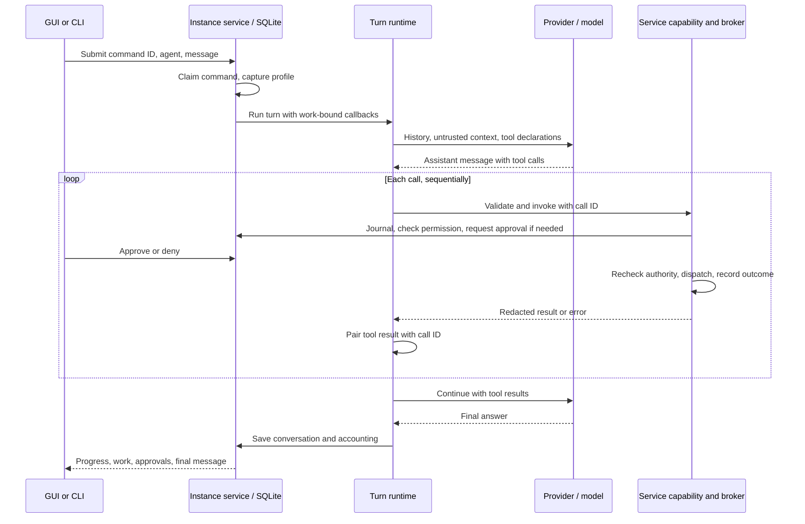

# Code Mode architecture grounding

Checked 2026-11-03 against Staf source at `9eb4272` and the owner-confirmed [ADR-0005](../../adr/0005-service-owned-code-mode.md). This is read-only source and decision-lineage evidence. No Staf provider, sandbox, container, app server, or runtime test was run. The sections below preserve the how explainer and why synthesizer reports; citations distinguish observed behavior from accepted future requirements.

## Current runtime

### Overview

Staf’s shared main chat runs through the **instance service**, which owns the command, conversation, permissions, approvals, action records, and cancellation. The GUI and terminal are clients of that service. The model sees function declarations and returns tool calls; it never receives the service’s authority merely by producing a call.

[ADR-0005](../../../docs/adr/0005-service-owned-code-mode.md) confirms Code Mode as the **future target after a bounded experiment passes**. It is not implemented today. A primary code tool must preserve the current service-owned boundaries while adding the ADR’s stronger requirements for partial results, denial, expiry, concurrency, inspection, and recovery.

### Key Concepts

- **Command:** A client-submitted main-chat turn. The instance atomically stores the user message and a fingerprint, accepts only one pending command per agent, and treats an identical retry as a lookup rather than a second execution. It captures the agent profile at acceptance. [src/instance.ts:898](https://github.com/lancewilhelm/Staf/blob/9eb427232a44c3bc947caf79e0ad4cbd31fa8ea3/src/instance.ts#L898)
- **Turn runtime:** `runTurn` owns model iteration, argument validation, sequential tool dispatch, conversation messages, runtime events, and usage accounting. Its default is four provider requests per turn. [src/runtime.ts:40](https://github.com/lancewilhelm/Staf/blob/9eb427232a44c3bc947caf79e0ad4cbd31fa8ea3/src/runtime.ts#L40)
- **Service callbacks and broker:** The instance service binds each tool call to its command or task and enforces actual capability permissions. Web, search, and scratch actions use `ActionBroker` and the instance’s journal; the broker rechecks authority after approval and before dispatch. [src/instance-service.ts:86](https://github.com/lancewilhelm/Staf/blob/9eb427232a44c3bc947caf79e0ad4cbd31fa8ea3/src/instance-service.ts#L86), [src/action-broker.ts:72](https://github.com/lancewilhelm/Staf/blob/9eb427232a44c3bc947caf79e0ad4cbd31fa8ea3/src/action-broker.ts#L72)
- **Provider contract:** Providers translate between their protocol and Staf messages. A tool call has an ID, function name, and JSON argument string; its result is a string paired to that ID. [src/types.ts:3](https://github.com/lancewilhelm/Staf/blob/9eb427232a44c3bc947caf79e0ad4cbd31fa8ea3/src/types.ts#L3)
- **Skill and memory:** Skills are selectable untrusted instructions, not authority. Memory is retained owner-managed information recalled as untrusted context, not a model-facing mutation capability. [src/runtime.ts:87](https://github.com/lancewilhelm/Staf/blob/9eb427232a44c3bc947caf79e0ad4cbd31fa8ea3/src/runtime.ts#L87), [src/instance-service.ts:186](https://github.com/lancewilhelm/Staf/blob/9eb427232a44c3bc947caf79e0ad4cbd31fa8ea3/src/instance-service.ts#L186)

### How It Works

The service first handles recognized owner memory commands deterministically. Otherwise, it builds a provider from the captured profile and invokes `runTurn` with callbacks scoped to the command. Those callbacks are offered only where the capability is available. The runtime adds the available skill catalog and up to five relevant memories to a cloned provider request as untrusted context, rather than inserting them as ordinary persisted user text. [src/instance-service.ts:578](https://github.com/lancewilhelm/Staf/blob/9eb427232a44c3bc947caf79e0ad4cbd31fa8ea3/src/instance-service.ts#L578), [src/instance-service.ts:594](https://github.com/lancewilhelm/Staf/blob/9eb427232a44c3bc947caf79e0ad4cbd31fa8ea3/src/instance-service.ts#L594), [src/runtime.ts:80](https://github.com/lancewilhelm/Staf/blob/9eb427232a44c3bc947caf79e0ad4cbd31fa8ea3/src/runtime.ts#L80)

Provider events can supply provisional text, but dispatch requires a valid completed assistant message. Validation permits at most eight uniquely identified calls in one response. The runtime parses and validates each call’s arguments, invokes the matching callback, and appends a paired result before asking the provider again. It checks selected skills before subsequent requests and actions; a previously loaded skill body is not automatically reloaded into a new turn. [src/runtime.ts:97](https://github.com/lancewilhelm/Staf/blob/9eb427232a44c3bc947caf79e0ad4cbd31fa8ea3/src/runtime.ts#L97), [src/runtime.ts:130](https://github.com/lancewilhelm/Staf/blob/9eb427232a44c3bc947caf79e0ad4cbd31fa8ea3/src/runtime.ts#L130), [src/validation.ts:27](https://github.com/lancewilhelm/Staf/blob/9eb427232a44c3bc947caf79e0ad4cbd31fa8ea3/src/validation.ts#L27)

For web, search, and scratch, service-generated identities tie an action to the work and tool call, while fingerprints bind its payload and relevant configuration. The broker prepares the journal entry, evaluates policy, obtains and records approval when required, rechecks policy, claims a start permit, performs the effect, and records a safe outcome. An existing action ID returns status instead of dispatching again. Web redirects get separately checked actions. Grant claims and revocation remain instance-controlled. This guards against redispatch; it does **not** prove an external effect happened exactly once. [src/instance.ts:334](https://github.com/lancewilhelm/Staf/blob/9eb427232a44c3bc947caf79e0ad4cbd31fa8ea3/src/instance.ts#L334), [src/instance-service.ts:132](https://github.com/lancewilhelm/Staf/blob/9eb427232a44c3bc947caf79e0ad4cbd31fa8ea3/src/instance-service.ts#L132), [src/action-broker.ts:72](https://github.com/lancewilhelm/Staf/blob/9eb427232a44c3bc947caf79e0ad4cbd31fa8ea3/src/action-broker.ts#L72)

A code string could fit the existing provider contract as a string field in an ordinary function declaration, with a service-owned executor dispatching child actions through controlled callbacks. That is a placement inference, not an existing executor. Protocol compatibility alone does not prove that any particular live model, adapter, or connection can reliably generate and use such programs; ADR-0005 requires named model-and-connection evidence and a bounded experiment. [src/types.ts:22](https://github.com/lancewilhelm/Staf/blob/9eb427232a44c3bc947caf79e0ad4cbd31fa8ea3/src/types.ts#L22), [docs/research/code-mode-adoption.md:47](../../../docs/research/code-mode-adoption.md), [docs/adr/0005-service-owned-code-mode.md:102](../../../docs/adr/0005-service-owned-code-mode.md)

### Where Things Live

- [src/runtime.ts](https://github.com/lancewilhelm/Staf/blob/9eb427232a44c3bc947caf79e0ad4cbd31fa8ea3/src/runtime.ts#L40): model loop, tool declarations, validation, dispatch, conversation and failure handling.
- [src/instance-service.ts](https://github.com/lancewilhelm/Staf/blob/9eb427232a44c3bc947caf79e0ad4cbd31fa8ea3/src/instance-service.ts#L78): client API, live controllers and approval waiters, capability adapters, and progress publication.
- [src/instance.ts](https://github.com/lancewilhelm/Staf/blob/9eb427232a44c3bc947caf79e0ad4cbd31fa8ea3/src/instance.ts#L65): durable commands, sessions, permissions, action and runtime records, and restart recovery.
- [src/action-broker.ts](https://github.com/lancewilhelm/Staf/blob/9eb427232a44c3bc947caf79e0ad4cbd31fa8ea3/src/action-broker.ts#L72): policy, approval, recheck, permit, and effect lifecycle.
- [web/components/ChatWorkItems.vue](https://github.com/lancewilhelm/Staf/blob/9eb427232a44c3bc947caf79e0ad4cbd31fa8ea3/web/components/ChatWorkItems.vue#L9) and [src/terminal-instance.ts](https://github.com/lancewilhelm/Staf/blob/9eb427232a44c3bc947caf79e0ad4cbd31fa8ea3/src/terminal-instance.ts#L120): current client projections.
- [ADR-0005](../../../docs/adr/0005-service-owned-code-mode.md): confirmed future product and lifecycle requirements.

### Gotchas

**Deadlines and outcomes are not yet suitable for the ADR.** Web, search, and scratch callbacks currently start a five-minute abort timeout that includes approval waiting. Background-task execution timers pause while awaiting approval, but that does not pause these callback timeouts. The ADR instead calls for a separately bounded approval wait of up to 24 hours and a separate active execution limit. [src/instance-service.ts:89](https://github.com/lancewilhelm/Staf/blob/9eb427232a44c3bc947caf79e0ad4cbd31fa8ea3/src/instance-service.ts#L89), [src/instance-service.ts:112](https://github.com/lancewilhelm/Staf/blob/9eb427232a44c3bc947caf79e0ad4cbd31fa8ea3/src/instance-service.ts#L112), [src/instance-service.ts:134](https://github.com/lancewilhelm/Staf/blob/9eb427232a44c3bc947caf79e0ad4cbd31fa8ea3/src/instance-service.ts#L134), [src/instance-service.ts:230](https://github.com/lancewilhelm/Staf/blob/9eb427232a44c3bc947caf79e0ad4cbd31fa8ea3/src/instance-service.ts#L230), [ADR-0005:68](../../../docs/adr/0005-service-owned-code-mode.md)

The broker can distinguish denial and other outcomes, but the existing capability wrappers collapse them into generic errors; the runtime ordinarily converts those errors to string tool results and continues. Clock authorization has a separate failure path. A code runner needs typed denial, expiry, cancellation, failure, and uncertainty, plus a barrier against subsequent dispatch. Under the ADR, denial ends the script without an alternate route; expiry ends it as expired. Neither currently follows just from the string wrappers. [src/action-broker.ts:84](https://github.com/lancewilhelm/Staf/blob/9eb427232a44c3bc947caf79e0ad4cbd31fa8ea3/src/action-broker.ts#L84), [src/instance-service.ts:100](https://github.com/lancewilhelm/Staf/blob/9eb427232a44c3bc947caf79e0ad4cbd31fa8ea3/src/instance-service.ts#L100), [src/runtime.ts:143](https://github.com/lancewilhelm/Staf/blob/9eb427232a44c3bc947caf79e0ad4cbd31fa8ea3/src/runtime.ts#L143), [ADR-0005:44](../../../docs/adr/0005-service-owned-code-mode.md)

**Durability is split.** Clock approval requests are persisted; pending web/search/scratch approval waiters are service-owned in-memory maps, while decisions and action states are journaled. Journal summaries are deliberately safe and do not themselves retain all actual returned data. On an ordinary failed main-chat turn, conversation messages roll back to prior history, although accounting and events are attempted separately; recorded event detail is truncated. The ADR requires generated code, action history, and returned results retained with the conversation, including partial success. That needs an explicit bounded persistence and replay contract, not just the existing journal. [src/instance-service.ts:78](https://github.com/lancewilhelm/Staf/blob/9eb427232a44c3bc947caf79e0ad4cbd31fa8ea3/src/instance-service.ts#L78), [src/instance-service.ts:300](https://github.com/lancewilhelm/Staf/blob/9eb427232a44c3bc947caf79e0ad4cbd31fa8ea3/src/instance-service.ts#L300), [src/runtime.ts:210](https://github.com/lancewilhelm/Staf/blob/9eb427232a44c3bc947caf79e0ad4cbd31fa8ea3/src/runtime.ts#L210), [src/instance-service.ts:601](https://github.com/lancewilhelm/Staf/blob/9eb427232a44c3bc947caf79e0ad4cbd31fa8ea3/src/instance-service.ts#L601), [ADR-0005:81](../../../docs/adr/0005-service-owned-code-mode.md)

**Stop and restart are different from rollback.** Stop records `stopping`, aborts the controller, and settles with observed partial text as a stopped message; client disconnection does not itself stop work. Restart marks pending commands interrupted, interrupts persisted pending approvals, marks started journal actions uncertain, and cancels prepared actions. Uncertain scratch effects require owner review before further scratch work. ADR-0005 requires fresh script state and no automatic replay after restart; in-flight effects need explicit settlement and inspection before retry. [src/instance-service.ts:540](https://github.com/lancewilhelm/Staf/blob/9eb427232a44c3bc947caf79e0ad4cbd31fa8ea3/src/instance-service.ts#L540), [src/instance.ts:852](https://github.com/lancewilhelm/Staf/blob/9eb427232a44c3bc947caf79e0ad4cbd31fa8ea3/src/instance.ts#L852), [src/instance.ts:72](https://github.com/lancewilhelm/Staf/blob/9eb427232a44c3bc947caf79e0ad4cbd31fa8ea3/src/instance.ts#L72), [src/instance.ts:114](https://github.com/lancewilhelm/Staf/blob/9eb427232a44c3bc947caf79e0ad4cbd31fa8ea3/src/instance.ts#L114), [ADR-0005:22](../../../docs/adr/0005-service-owned-code-mode.md)

**The clients show a flatter picture than the ADR requires.** The GUI renders independent expandable requested/succeeded/failed event rows and matching approvals; the terminal prints tool names and status, provisional text, and exposes approval commands. The command-status API returns event type, name, and success without call IDs or details; the GUI’s chat-work projection can include bounded detail. Durable events have no parent-child action graph. Inspectable generated code alongside correlated child actions, including parallel reads, therefore needs new persistence and client projections. [web/components/ChatWorkItems.vue:9](https://github.com/lancewilhelm/Staf/blob/9eb427232a44c3bc947caf79e0ad4cbd31fa8ea3/web/components/ChatWorkItems.vue#L9), [src/terminal-instance.ts:120](https://github.com/lancewilhelm/Staf/blob/9eb427232a44c3bc947caf79e0ad4cbd31fa8ea3/src/terminal-instance.ts#L120), [src/instance.ts:873](https://github.com/lancewilhelm/Staf/blob/9eb427232a44c3bc947caf79e0ad4cbd31fa8ea3/src/instance.ts#L873), [ADR-0005:61](../../../docs/adr/0005-service-owned-code-mode.md)

A future executor must also preserve live skill validity, owner-only memory management, per-action permission and URL validation—including URLs constructed during execution—and capability limits. ADR-0005 permits bounded parallel independent reads, serializes changing actions, and presents approvals one at a time per agent. Executor isolation, language, exact resource and correction limits, child correlation, concurrent-wait accounting, and in-flight cleanup remain open technical decisions. Equivalent direct model tools retire only as migration succeeds; main-chat background-task calls are currently deferred. [src/runtime.ts:47](https://github.com/lancewilhelm/Staf/blob/9eb427232a44c3bc947caf79e0ad4cbd31fa8ea3/src/runtime.ts#L47), [src/instance-service.ts:187](https://github.com/lancewilhelm/Staf/blob/9eb427232a44c3bc947caf79e0ad4cbd31fa8ea3/src/instance-service.ts#L187), [src/runtime.ts:179](https://github.com/lancewilhelm/Staf/blob/9eb427232a44c3bc947caf79e0ad4cbd31fa8ea3/src/runtime.ts#L179), [ADR-0005:76](../../../docs/adr/0005-service-owned-code-mode.md), [ADR-0005:89](../../../docs/adr/0005-service-owned-code-mode.md)

This synthesis is based on static source review; no tests, services, authentication, or provider calls were run.

## Decision lineage and planning constraints

### The Question

Why does Staf place conversation state and action authorization in its shared service, retain uncertain outcomes instead of silently replaying effects, and show tool progress in simple chat? Which decisions constrain Code Mode, and which implementation details remain open?

### The Code in Question

At `9eb4272`, [runTurn](https://github.com/lancewilhelm/Staf/blob/9eb427232a44c3bc947caf79e0ad4cbd31fa8ea3/src/runtime.ts#L34-L40) is a transport-independent turn loop. The [action broker](https://github.com/lancewilhelm/Staf/blob/9eb427232a44c3bc947caf79e0ad4cbd31fa8ea3/src/action-broker.ts#L70-L111), [action journal](https://github.com/lancewilhelm/Staf/blob/9eb427232a44c3bc947caf79e0ad4cbd31fa8ea3/src/action-journal.ts#L55-L78), and [instance service](https://github.com/lancewilhelm/Staf/blob/9eb427232a44c3bc947caf79e0ad4cbd31fa8ea3/src/instance-service.ts#L86-L93) are existing action and integration points.

The owner-confirmed [ADR-0005](../../../docs/adr/0005-service-owned-code-mode.md) is **local and untracked**. It describes future Code Mode behavior, not an implemented or verified executor.

### What We Found

- **[Direct] Provider-independent continuity motivated Staf-owned conversation state.** The original decision says provider-owned conversations would reduce adapter work but make resume behavior and tool permissions vary by provider. Its stated tradeoff was repeated full history without compaction, within the then-small text-and-clock contract. [Original decision](https://github.com/lancewilhelm/Staf/blob/9eb427232a44c3bc947caf79e0ad4cbd31fa8ea3/docs/decisions.md#L3-L12).

- **[Direct] The shared instance owns continuing work so clients share one history.** Closing a web or CLI interface must not stop work or create a separate history. The owner also specified that clients reconnect to canonical service state and inspect uncertain submissions rather than silently submit again. [ADR-0001](https://github.com/lancewilhelm/Staf/blob/9eb427232a44c3bc947caf79e0ad4cbd31fa8ea3/docs/adr/0001-shared-instance-web-first.md#L3-L8); [issue #17 resolution](https://github.com/lancewilhelm/Staf/issues/17#issuecomment-6537715795).

- **[Direct] Authorization remains under the owner’s current limits.** Permissions determine what an agent may do; approval mode determines when it asks. A mode cannot enable a disabled tool or expand scope, and changes must be checked before the next action. Client authorization and provider authorization are separate. [Issue #2 resolution](https://github.com/lancewilhelm/Staf/issues/2#issuecomment-6453313751); [issue #5 resolution](https://github.com/lancewilhelm/Staf/issues/5#issuecomment-6454200689).

- **[Direct] Uncertain effects are retained because an action may already have changed something.** The MVP record requires preserving completed work and reviewing uncertainty rather than silently repeating a potentially completed effect. First-delivery task recovery narrowed this to interruption and explicit retry; safe automatic continuation was deferred. The later Code Mode decision independently specifies interruption without automatic script replay and checking uncertain effects before retry. [MVP recovery requirement](https://github.com/lancewilhelm/Staf/blob/9eb427232a44c3bc947caf79e0ad4cbd31fa8ea3/docs/mvp.md#L57-L60); [task recovery](https://github.com/lancewilhelm/Staf/blob/9eb427232a44c3bc947caf79e0ad4cbd31fa8ea3/docs/mvp.md#L148-L153); [ADR-0005](../../../docs/adr/0005-service-owned-code-mode.md).

- **[Direct] Simple chat is a later scope decision.** The 2026-11-02 decision puts actual tool use and brief status in the message list and defers the separate background-task and Activity workflow. It preserves the existing background-task implementation for later. Code Mode carries this forward with understandable progress, approvals and results, plus expandable code details that are not required reading for approval. [Decision record](https://github.com/lancewilhelm/Staf/blob/9eb427232a44c3bc947caf79e0ad4cbd31fa8ea3/docs/decisions.md#L231); [ADR-0005](../../../docs/adr/0005-service-owned-code-mode.md).

### What We Can Reasonably Infer

- **[Inferred] The architectural commitment is to the authority and recovery boundary, not the present class layout.** The policy decisions specify owner control and current checks, while the existing broker and journal implement particular identities, permits and states. A different Code Mode bridge could change those mechanics **if** it preserves the required behavior. The record does not establish that the existing broker alone covers every capability: clock and skills have separate checks. [Issue #2](https://github.com/lancewilhelm/Staf/issues/2#issuecomment-6453313751); [broker at `9eb4272`](https://github.com/lancewilhelm/Staf/blob/9eb427232a44c3bc947caf79e0ad4cbd31fa8ea3/src/action-broker.ts#L72-L111); [Code Mode research](../../../docs/research/code-mode-adoption.md).

- **[Inferred] A journal is evidence of observed actions, not an interpreter checkpoint.** The current journal records action states and results; research identifies the gap between an external effect and recording its outcome. Treating saved program state or a recorded call as proof that an effect is safe to repeat would therefore risk duplication. This is a technical risk, not evidence of a specific Staf incident. [Journal](https://github.com/lancewilhelm/Staf/blob/9eb427232a44c3bc947caf79e0ad4cbd31fa8ea3/src/action-journal.ts#L4-L14); [research](../../../docs/research/code-mode-adoption.md).

### Competing Hypotheses and Revisions

- **Broader MVP versus first delivery:** The earlier MVP text calls for background tasks, separate Activity and safe continuation where established. The later simple-chat decision expressly revises first-delivery UI scope; the task recovery decision defers automatic continuation. These do not establish a permanent ban on future Activity or proven safe continuation. [Earlier MVP](https://github.com/lancewilhelm/Staf/blob/9eb427232a44c3bc947caf79e0ad4cbd31fa8ea3/docs/mvp.md#L21-L25); [later decision](https://github.com/lancewilhelm/Staf/blob/9eb427232a44c3bc947caf79e0ad4cbd31fa8ea3/docs/decisions.md#L231); [recovery scope](https://github.com/lancewilhelm/Staf/blob/9eb427232a44c3bc947caf79e0ad4cbd31fa8ea3/docs/mvp.md#L148-L153).

- **Denial scope:** The general approval decision allows independent work to continue after denial; ADR-0005 ends the affected script and prohibits a workaround. These may apply at different scopes, but the design must make that relationship explicit rather than assume they are identical. [Issue #2](https://github.com/lancewilhelm/Staf/issues/2#issuecomment-6453313751); [ADR-0005](../../../docs/adr/0005-service-owned-code-mode.md).

### What We Don’t Know

- **[Unknown]** Why the specific broker and journal mechanics were selected: the focused history and PR discussions did not surface that rationale. Nor did they establish an incident that prompted the uncertain-effect rule.
- **[Unknown]** Which executor, generated language, isolation mechanism and exact execution limits will satisfy Code Mode. The owner-confirmed ADR leaves them open and requires a bounded experiment. [ADR-0005](../../../docs/adr/0005-service-owned-code-mode.md).
- **[Unknown]** Whether additional rationale exists in unsearched private conversations, unavailable operational systems or other documents. The searches below do not prove absence.

### Sources Consulted

- **Source control:** Focused blame and history through `9eb4272`; five named commits and PRs [#39](https://github.com/lancewilhelm/Staf/pull/39), [#45](https://github.com/lancewilhelm/Staf/pull/45), [#52](https://github.com/lancewilhelm/Staf/pull/52), [#54](https://github.com/lancewilhelm/Staf/pull/54), and [#56](https://github.com/lancewilhelm/Staf/pull/56). PR-reported checks were not rerun.
- **Tracker:** Issues #2, #5, #6, #15, #17, #19, #22, #26 and #53, plus keyword searches. Exact searches for “action broker” and “code mode” returned no issues.
- **Long-form:** Local decisions, MVP, ADRs and Code Mode research; Drive metadata searches for “Staf” and “Code Mode” found no identifiable Staf design record.
- **Public real-time chat:** Exact `Staf` search in public channels of Homies Only Productions returned no results. Private Slack and DMs require consent and were not searched; the unrelated School workspace was outside scope.
- **Infrastructure observability, error tracking, product analytics:** Not searched; the parent found no matching tool or MCP for these categories.

### Confidence Summary

The ownership, uncertain-effect and simple-chat rationales have direct decision-record support. The proposed freedom to replace individual implementation mechanics is an inference bounded by those decisions; no Code Mode execution or isolation claim has been verified.

### Planning Constraints

- **Preserve:** Instance-owned history, authorization and action records; current per-action permissions and revocations; exact actionable approvals; visible completed, failed and uncertain outcomes; cross-client continuity and Stop. Preserve existing capability boundaries and the native/Docker deployment requirements. [ADR-0005](../../../docs/adr/0005-service-owned-code-mode.md); [issue #53 brief](https://github.com/lancewilhelm/Staf/issues/53#issuecomment-6590997322).
- **Change:** The executor, language, bridge, correlation model and internal broker/journal mechanics can be evaluated. After the bounded experiment passes, migrate existing main-chat capabilities and retire equivalent direct model tools as migration succeeds; retain normal chat and deterministic GUI/CLI operations. [ADR-0005](../../../docs/adr/0005-service-owned-code-mode.md).
- **Avoid:** Automatic script replay after restart, repeating completed or unresolved effects, inventing progress, expanding service methods into agent authority, or routing around a denied action. Distinguish provider message replay from replaying external effects. [ADR-0005](../../../docs/adr/0005-service-owned-code-mode.md); [research](../../../docs/research/code-mode-adoption.md).
- **Risk:** Isolation and enforcement on every child call; pending and in-flight calls on Stop or expiry; bounded approval waits, concurrency and cleanup; partial outcomes; and model reliability across named connection/model combinations all require evidence before adoption. [ADR-0005](../../../docs/adr/0005-service-owned-code-mode.md).

