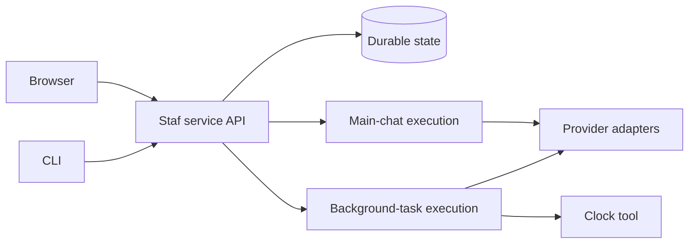

# First connected bot delivery: spec outline

Status: historical review draft. The accepted [delivery specification](https://github.com/lancewilhelm/Staf/issues/19)
and its implementation sub-issues supersede this outline for the handoff. This
outline is not a claim of deployed behavior.

Planning context: [incremental MVP map](https://github.com/lancewilhelm/Staf/issues/1),
[first-delivery milestone](https://github.com/lancewilhelm/Staf/milestone/1),
[initial bot contract](first-delivery-bot-contract.md),
[accepted approval policy](https://github.com/lancewilhelm/Staf/issues/2#issuecomment-6453313751),
and [accepted deployment policy](https://github.com/lancewilhelm/Staf/issues/5#issuecomment-6454200689).

## Problem and intended result

Staf currently provides a local conversation loop. The owner cannot yet connect
web and CLI to a shared always-on bot, continue a conversation while background
work runs, or inspect durable Activity after a client disconnects.

This delivery makes that experience work through one instance: pair a client,
create a named bot, chat with it, start one read-only background task, keep
chatting, inspect Activity, stop work and reconnect to the same state. Installation
and recovery must be usable on the owner's Linux VM, with Docker as an alternative.
This is the first delivery toward the full MVP, not the complete MVP.

## Accepted requirements

- Native Linux VM is the first documented installation; Docker uses the same
  configuration and API. Both are self-hosted.
- One continuously running instance owns state and work. A public address,
  domain and external hosting are not prerequisites for local-network use.
- CLI or browser can configure the instance. Setup should be as simple as possible.
- One owner authorizes browser/CLI clients through a one-time code on the host.
  Clients remain trusted until revoked and can be inspected/revoked.
- Bots have name, instructions, a customizable starting soul, their own model
  settings copied at creation, and a persistent main chat. Later creation-default
  changes affect future bots only; the owner edits an existing bot explicitly.
- Main chat remains available during background work. Detailed actual steps and
  results appear in a separate Activity view and equivalent CLI task views.
- Only the existing clock/read-only demonstration is needed to prove the first
  background-task path. Shell, web execution and recurring schedules come later.
- Reconnect restores saved conversation and progress without duplicate command
  submission. New commands require a live connection; no offline outbox is needed.
- Follow the accepted permissions/approval policy, including live revocation.
- Offer a service that starts after reboot, with start/stop/status/log access.
  Updates are owner-initiated, preserve configuration/data and create recoverable
  backups before stored-data format changes. Document restore to a replacement host.

## Core user stories

1. As the owner, I can install and start the instance without a public domain.
2. I can configure the same instance through CLI or browser, including when no
   working model is configured yet.
3. I can pair another browser or CLI and revoke its future access.
4. I can create a named bot with just a name and instructions, then customize it.
5. I can inspect and edit a bot's own copied provider/model/reasoning settings
   without a change to creation defaults silently changing that bot.
6. I can switch between web and CLI and continue the same bot's main chat.
7. I can start a read-only background task and receive its stable identity.
8. I can get a useful main-chat reply while that task is still running.
9. I can inspect actual task steps, outcomes, failures and required approvals.
10. I can request a stop and distinguish acknowledgment from confirmed stopping.
11. I can reconnect to existing work without submitting the original request again.
12. I can inspect interrupted work after a service restart and choose what to retry.
13. I can update the installation and recover my data without assuming a provider
    grant will always remain valid on a replacement host.

## Initial bot behavior

Use the [bot contract](first-delivery-bot-contract.md) for the accepted behavior.
The owner accepted creation, duplicate names, active-work snapshots, conflicting
edit handling and archive/restore, and replaced live settings inheritance with
copies at creation. The [creation-defaults ADR](adr/0002-copy-bot-creation-defaults.md)
records that correction. The owner confirmed the complete bot agreement in the
[accepted resolution](https://github.com/lancewilhelm/Staf/issues/14#issuecomment-6455172896); the task behavior review below is recorded separately.

## Accepted execution behavior

The owner accepted the eight first-delivery task recommendations on 2026-10-27.
See the [background task review](mvp.md#first-delivery-background-task-review--2026-10-27).
The owner confirmed the complete agreement on 2026-10-27; the
[accepted resolution](https://github.com/lancewilhelm/Staf/issues/15#issuecomment-6458013516) closes the task decision.
Mechanisms explicitly labelled proposed below still require specification.

| ID | Reviewed behavior | Status |
| --- | --- | --- |
| E1 | Allow one background task per bot while main chat stays responsive. An additional background request reports busy and identifies existing work. | Accepted behavior; serializing main-chat requests remains a proposed service mechanism. |
| E2 | Give each task relevant starting context and separate work output. Later messages must explicitly target it. Main chat receives announcements, owner-input requests and outcomes; Activity holds detail. | Accepted |
| E3 | Show stopping separately from confirmed termination, and distinguish failures and interruption. | Accepted distinction; queued/running/waiting-for-approval/stopping/completed/failed/cancelled/interrupted remain proposed state labels. |
| E4 | Preserve actual task steps, tool results, errors and outcomes even when a later model response fails. | Accepted |
| E5 | A client disconnect leaves work running. After instance restart, preserve records and mark unfinished work interrupted; explicit retry creates a linked new attempt. | Accepted first-delivery policy; automatic safe continuation remains later work. |
| E6 | A stop request prevents new steps and requests abort; remain stopping until execution settles. Preserve late output and retain an already completed outcome. | Accepted behavior; durable service ordering is the proposed race-resolution mechanism. |
| E7 | Use an adjustable five-minute execution limit, excluding approval waits. Reaching the limit requests a stop and records the reason. Failures remain visible and retry is explicit. | Accepted; retain the existing four-step provider-loop cap and adapter timeouts as implementation proposals, not newly approved product limits. |

Ordinary replies stay in main chat. The owner may request background work, or the
bot may create a task for work needing separate execution within existing
permissions and approved scope. Announce its objective and stable identity.

Agreed E2: normal main-chat context sees task status and the completed result,
not the live worker transcript. A task uses captured bot instructions and relevant
initiating context without reading later main-chat turns automatically.
A specific new directive must explicitly target that task.

The service orders task notifications with main-chat changes. Activity can update
while a main-chat turn is in flight; append the corresponding chat notification
at a safe boundary after that turn commits or fails. A stale conversation
snapshot must not overwrite an independently recorded task event or notification.

For the first demonstration, use the accepted stop-and-replace behavior for a changed task
objective: acknowledge the stop, then create a linked replacement after it stops.
Preserve the original objective, events and outcome. Do not claim live arbitrary
redirection has been designed merely because the full MVP requires steering.

Task execution must wait for the task record to be durable. Provider errors,
cancellation and usage remain visible even when no assistant reply commits.
Revoked permissions and stricter approval settings are checked before the next
action regardless of a run's captured profile revision.

## Accepted interaction direction

The owner confirmed layout A as the starting point for a simple web UI. Main
chat stays visible beside the selected bot's Activity on desktop. Activity lists
tasks and shows the selected task's actual steps, status and result. Chat carries
brief task announcements and outcomes, links to details and remains available
during work. The owner can explicitly direct or stop a task in chat, and Activity
also offers Stop. Previously accepted task and approval behavior still applies.

The CLI connects to the same bot, chat and task records. It lists and inspects
tasks and can follow progress. Leaving that view does not stop the work. Exact
commands, responsive behavior, labels and visual polish remain open. The
[prototype](https://github.com/lancewilhelm/Staf/blob/5ef5c333d590e85762c33f95f189de40053805c8/prototypes/first-delivery/index.html)
uses synthetic data and is not production code. See the [confirmed resolution](https://github.com/lancewilhelm/Staf/issues/16#issuecomment-6537511518).

## Shared service and persistence

The owner confirmed the initial [shared-state direction](https://github.com/lancewilhelm/Staf/issues/17#issuecomment-6537715795) on
2026-10-30. One Staf instance owns shared records in SQLite. Web and CLI use the
same service, and a clean start is sufficient for first delivery. The following
requirements and proposed mechanisms distinguish product behavior from details
that still require specification and verification:

- Web and CLI call one authenticated service command/query interface. Clients
  do not directly edit server profiles, transcripts or task records.
  A configured client reports an unavailable instance rather than silently
  falling back to a separate local conversation store or another provider.
- Commands carry a unique command ID and expected revision when changing an
  existing profile. A duplicate ID with the same payload returns its stored
  result; a different payload conflicts. Distinguish accepted work from completed work.
- A small HTTP JSON API with live updates and stable IDs is the recommended
  direction. A resumable event stream and cursor are proposed mechanisms. Exact
  routes, event transport and authentication remain to be specified and verified.
- Store shared records in SQLite. Atomically persist the state changes and
  command/event records needed to acknowledge them. Separate bot profile and
  main-chat identity, messages, task attempts, task events, command results and
  usage; schema details remain open.
- Accept one main-chat request at a time per bot. Report busy to another client
  and retain its unsent text for an explicit retry. A separate background task can
  continue while main chat is in use. Prevent stale chat changes from overwriting
  independently recorded task events.
- Retain normalized history, provider/model-bound replay and usage attribution.
  A request's failed assistant reply must not erase task events or already observed usage.
- Keep provider grants in the instance's separate credential boundary. Never put
  them into bot profile snapshots, task briefs, events, client bundles or archives
  without an explicit credential-backup design.
- Assume a clean start. Preserve existing conversation files unchanged; import
  or migration is not required for this delivery. Document the first version's
  context-size limits; do not invent compaction behavior.
- On reconnect, restore saved chat and task progress. Check a submission whose
  acknowledgment was lost and show uncertainty where necessary. Do not silently
  submit it again or queue new offline submissions. Verify backup and restore for
  native and Docker installations.

The diagram shows the agreed shared-instance boundary. SQLite is selected; the
framework, service manager and client library remain open. No service or SQLite
storage has been implemented by this decision.

## Verification approach for review

On 2026-10-30, the owner agreed to repeatable offline behavior tests and actual
native Linux and Docker checks for installation and recovery. Provider sign-in
and inference have separate live checks when authorized; report them as
unverified until run. Before accepting the complete delivery, verify a supported
setup path and a basic live conversation for both Codex and OpenRouter, including
the designed remote setup path where applicable. An unrun or failed check remains
an acceptance gap. The specific test seam below remains a recommendation.

Recommend the service command/query/event boundary as the main behavior-test seam.
Use real temporary durable storage, a controllable clock and deterministic offline
providers; hold a background task on a test gate while a main-chat request completes.
This proves concurrency without relying on an arbitrary sleep or a live model.

Existing tests already exercise the conversation loop with injected providers,
clock and storage; CLI subprocess resume; settings precedence and next-request
changes; usage persistence; provider replay and failure boundaries; and PTY menus.
Reuse those patterns and keep provider fixture coverage rather than replacing it
with a claim that every live account/model works.

New acceptance examples:

- A paired browser creates a bot; CLI reads the same bot and main chat. Renaming
  changes the label without changing history or identity.
- A repeated create/start command returns one durable result. Conflicting profile
  revisions are visible rather than overwriting a newer edit.
- With a task held in running, a main-chat reply completes before the test gate
  releases. Both clients receive the same persisted task events and terminal result.
- Cancelling waiting/running work, disconnecting a client, losing an event-stream
  connection and restarting the instance preserve truthful status and history.
- Profile edits affect new work; permission revocation affects the next action of
  already accepted work. Revoking a client blocks its future API use.
- Cancellation reaches the actual selected adapter and rejects late results
  according to E6. In particular, fix and verify the known OpenRouter transport
  abort gap; rejecting a late response alone is not transport cancellation and
  cannot establish that the provider stopped processing or charging.
- Failure after an observed tool result retains that event and observed usage,
  even if the conversation turn rolls back.
- Native Linux service install/reboot, Docker state persistence, shared setup,
  pairing/revocation, update-with-backup and restore have explicit operational
  checks. Record which were actually run on a VM/container and which remain unverified.

Live provider sign-in/inference checks require explicit authorization. The
existing local/dummy OAuth coverage and recorded smoke tests do not establish
remote VM sign-in or new operational deployment behavior. No new live test is
performed or authorized by this outline.

## Delivery slices

The owner agreed to this sequence on 2026-10-30. It does not add an
all-design-first gate. Each slice must end in an observable user path with
relevant tests and documentation. The complete journey remains the first
delivery acceptance target.

1. **Connected bot and chat.** Pair a client with a foreground native instance,
   create/edit a bot, and continue its persisted main chat through web and CLI.
   Include clear provider setup/readiness behavior. Start with offline demo for
   repeatable verification and retain configured live-provider paths.
2. **Background work and Activity.** Start a read-only task, keep main chat usable,
   inspect real task events, handle approval prompts when the mode requires them,
   stop work, and recover truthful state after reconnect/restart.
3. **Install and recover the delivery.** Complete native Linux service and Docker
   packaging, CLI/browser setup parity, owner-controlled update/backup/restore,
   and documented provider setup from a client on a different machine.

The first slice can be specified and built when its own bot, service, access and
verification choices are coherent. Background-task and operational detail should
not delay every part of connected chat unless they impose a genuine interface or
data constraint. Later slices extend the same service and records.

## Decisions to finish in the draft

- Initial bot setup and first-delivery background task behavior are resolved,
  including an adjustable five-minute execution default. This duration is a
  chosen starting default, not a measured performance claim.
- Specify and verify the confirmed SQLite and shared-client contract, including
  acknowledgments, reconnect, conflict handling and backup/restore. Existing
  conversation import is not required for the clean start.
- Verify the pairing/transport and credential-storage design for local-network
  clients before claiming authenticated LAN access is ready.
- Establish a supported provider sign-in route for browser-on-laptop/agent-on-VM.
  Current direct Codex sign-in only binds the Staf host's loopback callback; the
  [research reference](deployment-options.md#provider-setup-on-a-remote-instance)
  records the gap. Do not promise remote guided sign-in on the existing local tests.
- Carry the confirmed [chat and Activity direction](https://github.com/lancewilhelm/Staf/issues/16#issuecomment-6537511518) into the
  implementation specification. Refine responsive behavior and visual details
  during implementation; do not wait for the later full-MVP collaboration prototype.
- Use the agreed behavior-test seam and the implementation sub-issues under the
  [published specification](https://github.com/lancewilhelm/Staf/issues/19).

## Scope exclusions and evidence

Memory retrieval, automatic skill lifecycle, shell/web tools, recurring schedules,
bot collaboration, autonomous soul rewriting, household accounts, native mobile
and Electron remain outside this first delivery. They remain in the full MVP
plan where previously agreed; no overall requirement is removed by this outline.

Current code has provider adapters, an offline clock/demo loop, deterministic
settings, local conversation snapshots and usage/replay handling. It has no bot
profile model, shared web/client service, durable background-task service, pairing,
Activity app or compaction. Earlier offline test results and recorded live checks
are documented in the [MVP delivery record](mvp.md#delivered-in-this-implementation)
and [direct provider verification](direct-responses.md#verification-and-remaining-gaps).
This draft is based on source/test inspection, not a fresh runtime test run.
